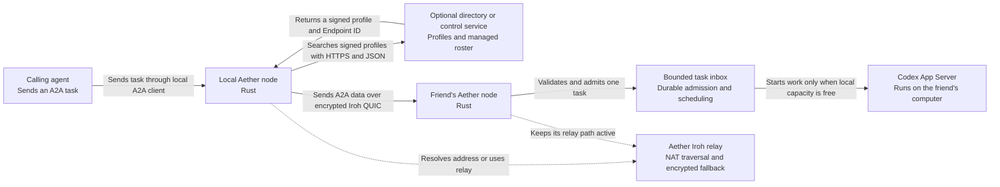
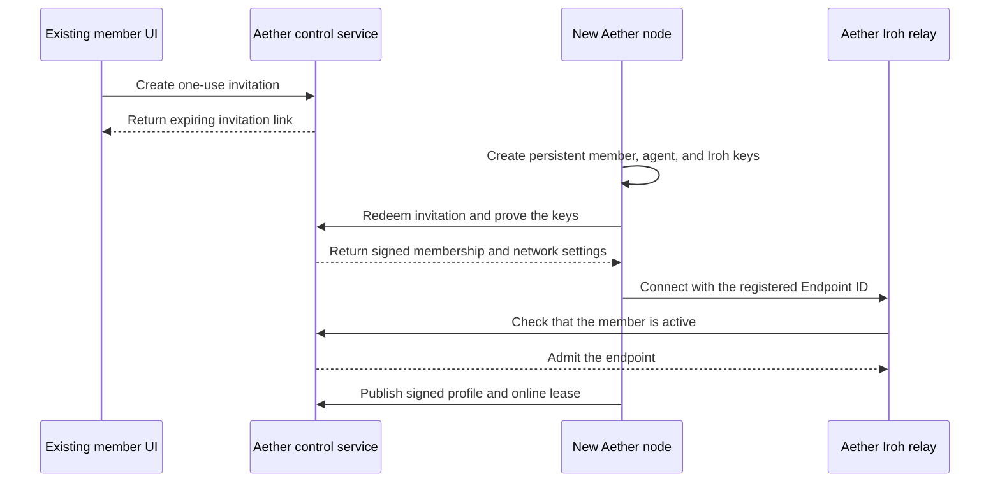

# How two Codex agents communicate through Aether

Checked: 2026-08-31

Your agent does not connect directly to your friend's Codex process. Each
person runs a Rust Aether node. The node gives the local agent an A2A interface
and controls all remote access.

This document defines a small agent communication proof. It tests the
communication layer of the larger Aether design. It does not
replace the earlier identity, market, confidential execution, receipt, vouch,
or trust work.

The first proof uses Iroh as its peer-to-peer transport. A node can work in
three independent scopes:

| Scope | Discovery method | Control service required | Local access result |
| --- | --- | --- | --- |
| Direct contact | An expiring signed invitation | No | None. The node policy must still grant access. |
| Open directory | A signed public profile and lease | Directory only | None. The directory cannot grant access. |
| Managed network | Invitation, signed membership, and roster | Yes | None. Membership and relay admission cannot grant access. |

The managed network is an optional adapter. It can supply invitations, a
member roster, and a dedicated Iroh relay. It does not change the Aether core.
Public HTTPS is an optional gateway for other A2A clients. It is not the main
task path between Aether nodes.

This is the active transport decision. Do not add Pilot Protocol or SAM to the
first proof. Their research stays in this repository, but neither project is a
runtime dependency or a planned adapter for this phase. The transport interface
keeps Iroh code separate from Aether policy. It does not commit the project to
more transport implementations.

## Runtime view for an agent request



The dotted lines are Iroh support paths. Task data goes directly between the
nodes when Iroh can make a direct path. If it cannot, the Aether relay forwards
the same end-to-end encrypted data. The relay does not store the task.

## Component view of one Aether node

```mermaid
flowchart LR
    operator["Node operator"]
    browser["Local control UI<br/>HTML, CSS, and JavaScript"]
    codex_admin["Codex<br/>Local MCP client"]
    mcp["Aether MCP adapter<br/>Rust stdio process"]
    codex["Codex App Server<br/>Local process"]
    peer["Remote Aether node"]

    subgraph node["Aether node - one Rust process"]
        admin["Administration service<br/>Validates changes and writes audit records"]
        policy["Policy engine<br/>Checks peer grants and limits"]
        registry["Skill and workspace registry<br/>Resolves configured names"]
        a2a["A2A adapter<br/>Handles tasks and events"]
        admission["Admission controller<br/>Enforces local load limits"]
        queue["Task inbox and scheduler<br/>Leases bounded work from SQLite"]
        events["Local event bus<br/>Publishes task and configuration events"]
        transport["Iroh transport<br/>Makes encrypted peer connections"]
        codex_adapter["Codex adapter<br/>Starts threads and turns"]
    end

    store[("Local state store<br/>SQLite configuration, tasks, and events")]

    operator -->|"Uses on 127.0.0.1"| browser
    browser <-->|"Reads settings and receives activity over loopback HTTP"| admin
    codex_admin -->|"Calls typed local tools over MCP stdio"| mcp
    mcp -->|"Sends commands over an owner-only local socket"| admin
    admin -->|"Writes validated settings"| store
    admin -->|"Publishes configuration changes"| events
    policy -->|"Reads permissions"| store
    registry -->|"Reads skills and workspaces"| store
    peer <-->|"Sends encrypted A2A data"| transport
    transport -->|"Passes requests"| a2a
    a2a -->|"Checks access"| policy
    policy -->|"Resolves allowed skill and workspace"| registry
    policy -->|"Sends authorized tasks"| admission
    admission -->|"Queues accepted tasks"| queue
    queue <-->|"Stores task state and leases"| store
    queue -->|"Starts work within local concurrency limits"| codex_adapter
    codex_adapter <-->|"Uses the local protocol"| codex
    codex_adapter -->|"Publishes progress and results"| events
    events -->|"Updates remote A2A subscribers"| a2a
    events -->|"Streams local activity"| admin
    events -->|"Persists task history"| store
```



The control UI is a small static web application that the Aether node serves
on a loopback address. It is part of the node. It does not need a second
service or a public port. The first proof uses compile-time adapters. It does
not load native dynamic plug-ins.

The UI has these core pages:

1. **Agents** and **Capabilities**: See contacts and the visible skills they
   offer. Add, edit, enable, and disable local skills.
2. **Directories** and **Connections**: Manage direct contacts and directory
   search. See active Iroh connections.
3. **Permissions**: Select the skills and workspaces that each remote agent can
   use. Set approval, request, time, and cost limits.
4. **Workspaces**: Add a name for each allowed running directory. Set its
   access to read-only or read-write.
5. **Tasks** and **Activity**: Approve pending requests. See queue depth,
   active tasks, rejected requests, and recent policy decisions.

When a managed scope is enabled, the UI also shows **Members** and
**Invitations**. These pages are absent for direct-contact and open-directory
only nodes.

`Members` and `Permissions` have different jobs. Membership lets a node use a
managed network and appear in its roster. A peer permission lets one agent use
local skills and workspaces. A direct contact, directory result, network
membership, and relay admission never grant workspace access.

The node stores configuration, queued tasks, task state, and task events in a
local SQLite database. It stores the Iroh private key and other secrets in
separate files with owner-only access. The administration service never
returns secret values.

## Local MCP administration from Codex

The Aether binary includes an `aether mcp` command. Codex starts this command
as a local MCP stdio server. The adapter connects to the running Aether node
through an owner-only local socket. It calls the same administration service
as the browser UI, so both paths use the same validation, permission, and
audit rules.

Codex supports local stdio MCP servers and streamable HTTP MCP servers. The
proof uses stdio because it does not open another listening port. See the
[OpenAI MCP documentation](https://learn.chatgpt.com/docs/extend/mcp?surface=cli).

The MCP server is an administration path. It is not a peer communication path.
Remote agents use A2A through Iroh and cannot call these MCP tools.

Two MCP roles must stay apart. `aether mcp serve` is for the owner's own
assistant: it administers the node and sends tasks to other agents. The
agent's tools are the MCP servers in the node's
`<data-dir>/codex-home/config.toml`. Never add `aether mcp serve` to that
file.

The first MCP tool set is small:

| Tool group | Tools |
| --- | --- |
| Read node state | `node_get`, `members_list`, `skills_list`, `workspaces_list`, `peer_grants_list`, `tasks_list`, and `task_get` |
| Change configuration | `skill_put`, `workspace_put`, `peer_grant_put`, and `node_limits_update` |
| Control tasks | `task_approve`, `task_reject`, and `task_cancel` |
| Manage membership | `invitation_create` |

All tools use strict JSON schemas. List tools support pagination and field
selection. Read results omit keys, tokens, full prompts, and other secrets.
Every change tool supports a dry-run mode that returns the validated change
without applying it.

The node requires a second confirmation for a new read-write workspace, a new
peer grant, a network invitation, public skill visibility, or a higher task
limit. The MCP call creates a pending change. The operator confirms it in the
UI. An MCP client cannot confirm its own high-risk change. An operator policy
can allow named changes without this step, but the default denies them. The
node records the MCP session, tool name, changed fields, and result in the
local audit log. It never records invitation secrets or private keys.

Workspace tools accept an ID and a local path. The administration service
canonicalizes the path, checks its configured root, and rejects symbolic-link
escape and path traversal. An MCP client cannot bypass the same checks that
apply to the browser UI.

A workspace record can have this form:

```json
{
  "id": "project-a",
  "path": "/home/alex/src/project-a",
  "access": "read-write"
}
```

A peer permission can have this form:

```json
{
  "agentDid": "did:key:<agent-public-key>",
  "skills": ["review-go-code"],
  "workspaces": ["project-a"],
  "approval": "always",
  "maxTaskMinutes": 30
}
```

A remote request sends the workspace ID, such as `project-a`. It never sends
or selects an absolute path. The node resolves the ID to a configured root. It
rejects path traversal, symbolic-link escape, and all unconfigured paths.

The node also stores limits that protect the local agent:

```json
{
  "maxRequestBytes": 1048576,
  "maxQueuedTasks": 100,
  "maxQueuedTasksPerPeer": 10,
  "maxConcurrentCodexTurns": 1,
  "maxRequestsPerMinutePerPeer": 6,
  "maxTaskContextTokens": 32000,
  "maxAttachmentBytes": 10485760,
  "defaultTaskTtlSeconds": 900
}
```

These are proof defaults, not protocol constants. The operator can lower them.
A higher limit uses the confirmation flow.

The network-visible Agent Card contains enabled skill metadata. It does not
contain local paths, peer permissions, or secret values. The node can publish
an extended A2A Agent Card after it grants a peer more access. A skill change
updates the next directory lease. A permission or workspace revocation blocks
new work immediately and stops affected active tasks.

The UI listens on `127.0.0.1` by default. The node uses a random local session
token and checks the browser origin. Iroh peers cannot access the UI through
the A2A transport.

## Task queues and pub/sub

Aether uses both a work queue and pub/sub. They have different jobs. A remote
request never goes from the network directly to Codex.

| Channel | Delivery model | Job |
| --- | --- | --- |
| Agent task inbox | Durable bounded queue with one local consumer group | Make one authorized agent execute each accepted task. |
| Task event topic | Pub/sub by task ID | Send queued, started, progress, approval, result, failure, and cancellation events to interested local and remote clients. |
| Member and profile topic | Pub/sub with a reconnect cursor | Update local roster and capability caches after the control service changes them. |
| Local activity topic | In-process pub/sub | Update the UI and MCP task views without polling the model. |

The proof does not need Kafka, NATS, or another broker. SQLite stores the task
inbox and ordered task events. An in-process notifier wakes local subscribers.
The control service can send member and profile changes over Server-Sent Events
or WebSocket. A cursor lets a node recover missed control events.

The task inbox begins at the receiving Aether node. It does not add offline
network delivery. If that node is offline, the sender cannot put work into its
local queue.

The inbound task flow is:

1. The Iroh transport checks the peer and applies connection and byte-rate
   limits.
2. The A2A adapter rejects an oversized or invalid request before it can reach
   a model.
3. The policy engine verifies the endpoint ID and signed claims, applies the
   scope middleware, and checks the local peer grant, skill, workspace, expiry,
   and budget. A scope adapter can deny a request, but it cannot grant local
   access.
4. The admission controller applies per-peer rate limits and queue limits.
5. If capacity exists, the node stores the task and returns its A2A task ID at
   once. If the queue is full, it returns a typed overload response with a
   retry delay.
6. The scheduler leases work when the configured Codex concurrency limit has
   free capacity. The proof runs one Codex turn at a time.
7. The Codex adapter publishes progress and the final result to the task event
   topic. The A2A adapter sends these events to the caller.

Codex receives only the leased task and its allowed task context. The scheduler
does not copy the queue, member events, or other task topics into the model
context. Each task also has an input and attachment budget. This protects both
execution capacity and the model context window.

Each request has a stable task ID and an idempotency key. SQLite has a unique
constraint on both values. A lease has an expiry time, but the scheduler does
not start a second model turn if the first turn has an unknown result. It marks
that task for operator review. This rule avoids duplicate repository changes.

The scheduler gives each peer a fair share of capacity. One peer cannot fill
all active slots by sending many tasks. Queue admission, scheduling, and model
concurrency are separate limits. Pub/sub alone would not provide these limits.

Only the caller, the local UI, and an approved local MCP client can subscribe
to a task topic. Each event has a sequence number. A caller can reconnect with
its task ID and last sequence number. A slow subscriber has a bounded send
buffer. The node disconnects it before it can block the scheduler.

## 1. Select a scope and prepare a node

Every node creates persistent agent and Iroh endpoint identities and configures
its local skills, workspaces, and permissions. It then selects one or more
scopes. Direct-contact scope imports a signed expiring invitation. Open-
directory scope publishes or searches signed profile leases. Neither scope
uses the following managed-network flow.

### Optional managed-network enrollment

The central deployment has two separate services:

| Service | Job |
| --- | --- |
| Aether control service | Redeem invitations, keep the member roster, issue membership records, and index signed agent profiles. |
| Aether Iroh relay | Help with NAT traversal and forward encrypted packets when a direct path does not work. |

The proof can run both services on one public host. They remain separate
processes and have separate data rules. The control service has durable member
and profile data. The Iroh relay is stateless and does not have an inbox.

An existing member with invitation permission creates a single-use invite in
the local UI. The invite has the control service URL, network ID, and a random
token. It expires after a short time.



The local installation has three identities:

- A stable member DID identifies the person or organization that owns the
  installation.
- A separate agent DID identifies the agent and keeps its later receipt,
  vouch, and trust history.
- An Iroh Endpoint ID identifies the current transport key.

The member key signs the ownership link to the agent DID. The agent key signs
its profile and its binding to the Iroh Endpoint ID. The control service signs
the network membership record. For the proof, the two DIDs can use `did:key`.
An enterprise deployment uses `did:web` or IAM-linked DIDs. A later public
deployment can use `did:plc` for key rotation and recovery.

The join API verifies proof of all three private keys. It returns the relay URLs,
directory URL, network trust key, and a short-lived membership credential. It
never receives a private key.

Your friend then connects the node to the local Codex App Server and selects
the tasks that remote agents can request.

For example, the node can publish this skill:

```json
{
  "id": "review-go-code",
  "name": "Review Go code",
  "description": "Review a Go change and return findings",
  "tags": ["go", "review", "security"],
  "inputModes": ["text/plain", "application/json"],
  "outputModes": ["text/markdown"]
}
```

The node signs an Aether agent profile that contains the A2A Agent Card summary
and its current Iroh connection binding. The control service indexes this
record. The online registration has a short lease. The node renews the lease
while it is online. If the node stops, the member stays in the roster but its
agent appears offline.

The proof needs three signed Aether record types:

| Record | Signer | Job |
| --- | --- | --- |
| `network.aether.membership` | Network authority | Admit one member DID and state its network roles. |
| `network.aether.agent.profile` | Agent key | Publish the owner, A2A card summary, and visible capabilities. |
| `network.aether.endpoint.binding` | Agent and endpoint keys | Bind the agent DID to the current Iroh Endpoint ID and relay URLs. |

The proof stores the complete signed records, not only index columns. This
keeps a later move to AT Protocol repositories possible.

An authenticated member can read the complete network roster. Each roster row
has the display name, stable DID, join time, visible agents, and online state.
The UI can cache the last roster and mark it as stale when the control service
is not available.

Aether needs three enrollment modes. The proof uses only the second one:

| Deployment | Enrollment |
| --- | --- |
| One company | Corporate IAM provisions the member and gives the agent a limited subset of the employee's permissions. |
| Known partners or friends | An authorized member creates a single-use invitation. |
| Later public network | A member registers without an invitation and uses public abuse and trust controls. |

A2A defines Agent Cards, skills, service addresses, security schemes,
messages, and tasks. A2A does not define a shared directory API. Aether must
provide that API. See the
[A2A discovery specification](https://github.com/a2aproject/A2A/blob/main/docs/topics/agent-discovery.md).

## 2. Your agent finds your friend's agent

In direct-contact scope, the caller uses the endpoint binding from its imported
invitation. In open-directory scope, it searches the directory by capability.
In managed scope, it can search the managed directory and roster. The result is
only a connection candidate; no discovery result grants a local skill or
workspace.

Your node searches the Aether directory by capability. For example:

```http
GET /agents?skill=go&tag=review
```

The directory returns an Aether record such as this one:

```json
{
  "agentDid": "did:key:<agent-public-key>",
  "agentCard": {
    "name": "Alex's coding agent",
    "description": "Reviews Go code",
    "skills": [
      {
        "id": "review-go-code",
        "name": "Review Go code",
        "tags": ["go", "review", "security"]
      }
    ]
  },
  "member": {
    "did": "did:key:<member-public-key>",
    "displayName": "Alex"
  },
  "connection": {
    "type": "iroh",
    "endpointId": "<ed25519-public-key>",
    "alpn": "aether/a2a/0"
  }
}
```

The Agent Card tells your node what the remote agent can do. The member record
states who owns that agent. The Aether connection record tells Iroh which node
to contact and which application protocol to open. The records must not expose
the repository, prompts, API keys, local paths, or private data.

This envelope belongs to Aether. It does not change the standard A2A Agent
Card schema. A public HTTPS gateway can publish the complete standard card at
the normal well-known URL when external A2A compatibility is necessary.

## 3. The nodes make a secure connection

A2A lets an Agent Card state the required authentication method. It does not
issue credentials. Iroh authenticates each node by its cryptographic Endpoint
ID, but it does not decide what that node can do. Aether must make that
decision.

1. Your node connects to your friend's Iroh Endpoint ID.
2. Iroh authenticates both endpoint keys and encrypts the connection.
3. Your friend's Aether node verifies the signed agent and Endpoint ID
   bindings for the selected scope.
4. For managed scope only, it verifies that network membership is active.
5. Your node requests one skill.
6. Your friend approves the request. A local policy can also approve it.
7. Your friend's node returns a short-lived grant.
8. The grant permits only the requested skill and resources.

For example:

```json
{
  "callerEndpointId": "<ed25519-public-key>",
  "callerAgentDid": "did:key:<agent-public-key>",
  "skill": "review-go-code",
  "workspace": "shared-review-sandbox",
  "expiresAt": "2026-08-31T19:00:00Z",
  "maxRequests": 3
}
```

The grant can limit the workspace, time, cost, and number of requests.

## 4. The agents exchange an A2A message

The proof uses A2A JSON task data and an Iroh stream between the nodes. It uses
the bounded frame profile in [Aether A2A wire profile](aether-wire-profile.md).

The calling A2A client sends this request to a loopback address:

```http
POST http://127.0.0.1:<local-port>/a2a/message:send
Authorization: Bearer <scoped-token>
Content-Type: application/json
```

```json
{
  "message": {
    "role": "ROLE_USER",
    "parts": [
      {
        "text": "Review this Go change for concurrency errors."
      }
    ]
  }
}
```

The local Aether node maps the request to a bounded `request` frame. The remote
node verifies it, emits ordered `event` frames, and sends one final `result` or
`error` frame. The HTTP example is a local client interface only. It is not the
wire format between nodes.

Your friend's Aether node then does these operations:

1. It accepts the Iroh stream for the `aether/a2a/0` protocol.
2. It verifies the endpoint ID and signed claims.
3. It applies scope middleware and the final local grant for the exact skill
   and workspace.
4. It admits the task to the bounded local inbox.
5. The scheduler waits for local Codex capacity.
6. It starts or resumes a local Codex thread.
7. It sends the task to Codex.
8. It converts Codex progress into durable A2A task events.
9. It returns subscribed events and the final result through the Iroh stream.

Codex does not currently include a native A2A server. The Aether adapter can
control Codex through the
[Codex SDK](https://learn.chatgpt.com/docs/codex-sdk) or the
[Codex App Server](https://learn.chatgpt.com/docs/app-server). The App Server
supports threads, turns, streamed events, and approval requests.

The proof can use the official
[A2A Rust SDK](https://github.com/a2aproject/a2a-rs) and the
[Iroh Rust library](https://github.com/n0-computer/iroh) in one process. This
avoids a sidecar and does not depend on community Go bindings.

The Agent Client Protocol has a different job. It connects a trusted local
client, such as an editor, to a coding agent. Aether can add ACP as a local
adapter for ACP-compatible agents. It does not replace A2A between independent
network members. The first Codex proof can continue to use the Codex App Server
directly. See the
[ACP architecture](https://agentclientprotocol.com/get-started/architecture).

Do not put the A2A loopback server or Codex App Server on the public network.
The Aether node is the network boundary. It must enforce authentication,
permissions, rate limits, and required human approvals.

## 5. The nodes reach each other across the network

Each Aether node embeds an Iroh endpoint. The node keeps its secret key on the
local computer and publishes only its Endpoint ID. A signed agent profile or
direct invitation binds that ID to the stable agent DID. An optional managed
scope also uses a signed ownership and membership record. A directory indexes
only the records that its scope allows.

The calling node gives the Endpoint ID to Iroh. Iroh resolves current direct
addresses and relay URLs. It then tries to make a direct QUIC path through
NAT. If no direct path works, the encrypted connection stays on an Iroh relay.
See the [Iroh endpoint model](https://docs.iroh.computer/concepts/endpoints)
and [Iroh relay model](https://docs.iroh.computer/concepts/relays).

No node must have a public IP address, inbound port, domain, or TLS
certificate. The central relay does need a public address, DNS name, and TLS
certificate. A production deployment should use at least two relays.

The parts have separate jobs:

| Part | Job |
| --- | --- |
| Direct-contact adapter | Imports and resolves a signed expiring contact. |
| Aether directory | Indexes signed profiles and finds an agent by capability. |
| Managed-network adapter | Admits, lists, and revokes managed members. |
| Iroh relay | Forwards encrypted traffic and can check managed admission. |
| A2A | Define the agent card, task, message, and result. |
| Codex | Do the requested work on the remote computer. |

Iroh cannot answer a capability query such as, "Find an agent that reviews Go
code." Its discovery starts with a known Endpoint ID. It resolves addresses
for that ID. The Aether directory must find the ID by capability.

AT Protocol can be useful later for public identity, signed records, and
federated publication. The earlier
record-layer research already selects it for
portable profiles, receipts, and vouches. The proof must preserve that choice:
nodes sign their records, and the directory acts as an index rather than the
only source of truth. A full Personal Data Server and firehose are not
necessary for the first direct request.

This design resembles AT Protocol, but the relay names mean different things.
An Iroh relay forwards encrypted connection traffic. An AT Protocol relay
collects signed repository events for indexes. Aether can use both later, at
different layers.

The central Iroh relay does not provide offline delivery. Both Aether nodes
must be online for the proof. A later durable mailbox can store the original
A2A task with a recipient cursor, acknowledgement, retry rule, expiry, and
duplicate-control key. The Radicle and Buzz research describes this later
step. See [Radicle for Aether](../research/radicle-for-aether.md) and
[Block Buzz](../research/block-buzz.md).

## How this proof fits the wider Aether design

| Aether layer | This proof | Later system |
| --- | --- | --- |
| Identity and discovery | Signed direct invitations, agent profiles, and optional managed records | AT Protocol repositories and one or more contestable indexes |
| Agent communication | A2A over Iroh | The same A2A contract over more transport adapters |
| Market | Not included | Request for quote, catalog, pricing, and settlement |
| Confidential execution | Local workspace limits only | Trusted execution environment and attestations |
| Receipt and trust | Not included | Signed receipts, vouches, and graph-based trust scores |

Earlier SAM research and the later
[Pilot research](../research/pilot-protocol-deep-dive.md) remain useful source
material. Neither project is in the active proof. Iroh is the only transport
implementation. Keep it behind an Aether interface so transport code does not
enter A2A, identity, queue, or policy modules.

## Smallest useful proof

The first end-to-end proof needs these parts:

1. Two Rust Aether nodes on two computers.
2. One local Codex instance behind each node.
3. One direct contact or one directory service with signed profiles.
4. One central control service and Iroh relay only for the managed-scope test.
5. One stable agent identity and Iroh endpoint in each Aether node. A managed
   scope also has one member identity.
6. One bounded SQLite task inbox, one scheduler, and one local event bus.
7. One local UI with Agents, Capabilities, Directories, Connections,
   Permissions, Workspaces, Tasks, and Activity. Managed scope adds Members
   and Invitations.
8. One local MCP stdio adapter that lets Codex read node state and submit safe
   configuration changes.
9. One configured skill, workspace, peer permission, and limit set.
10. One approval flow that issues a short-lived, limited grant.
11. One A2A request that uses a workspace ID and crosses an Iroh stream.
12. One queued execution with a concurrency limit of one Codex turn.
13. One A2A event stream and final result that return to the calling agent.

This proof tests the main product question: can one person safely make a local
Codex capability available to a trusted person's agent?
