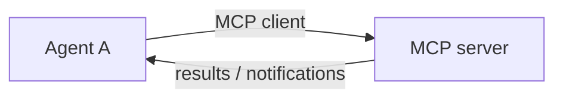
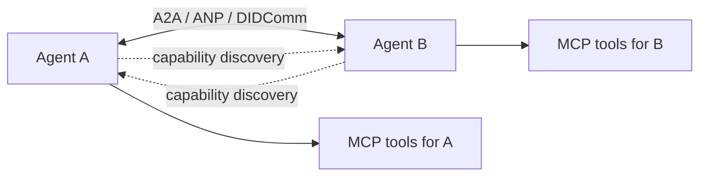
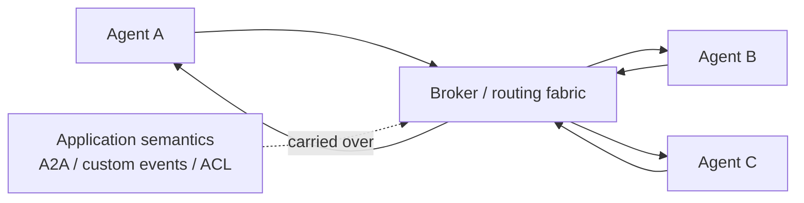
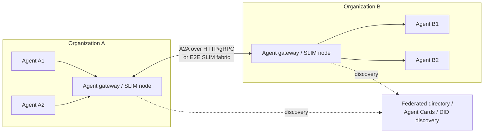
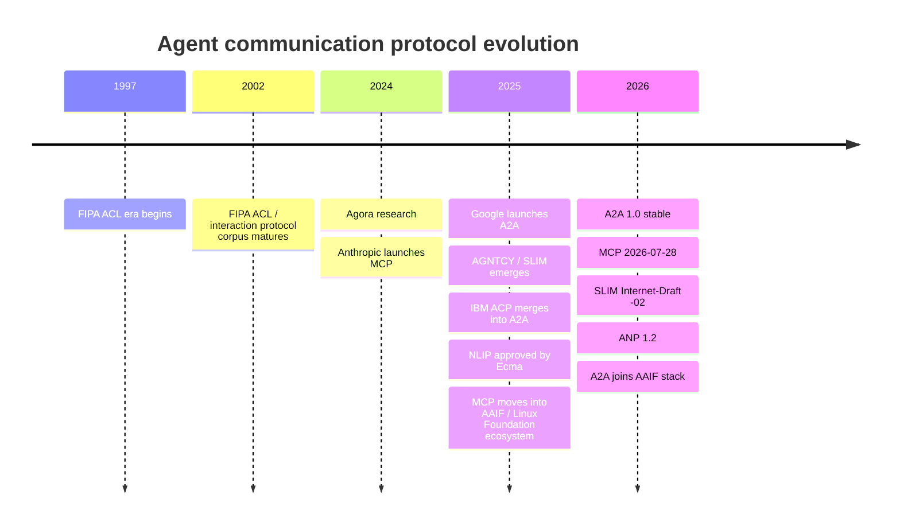

# Agent-to-Agent Communication Protocols: State of the Art in 2026

## Executive summary

As of **October 11, 2026, the dominant architecture is not “MCP talking to MCP.”** The industry is converging on a layered model:

**MCP for agent ↔ tools/data; A2A for agent ↔ agent; specialized messaging/network layers such as SLIM or DIDComm when stronger routing, group communication, federation, or end-to-end security is required.** Google explicitly designed A2A as complementary to MCP, and the current A2A and MCP documentation makes the same distinction. MCP's current protocol is deliberately asymmetric—clients issue requests to servers, while servers do not initiate JSON-RPC requests—so treating two MCP endpoints as symmetric autonomous peers requires an orchestration/adapter layer outside MCP itself. citeturn21search2turn21search9turn15view0

**A2A 1.0 is presently the strongest general-purpose choice for cross-framework LLM-agent interoperability.** Originally developed by Google and now governed in the Linux Foundation/Agentic AI Foundation ecosystem, it standardizes agent discovery through Agent Cards, messages/tasks/artifacts, streaming and asynchronous work, authentication, capability declaration, and multiple wire bindings. By 2026 the project reported participation from more than 150 organizations and integrations into Google Cloud, Microsoft Azure and AWS ecosystems. citeturn5view0turn19view3turn19view4

Two other architectural directions matter. **SLIM** is a lower-level, secure messaging fabric intended to transport protocols such as A2A and MCP; it adds pub/sub, multicast, RPC, routing and MLS end-to-end encryption and is particularly attractive for large distributed agent networks. **ANP** takes a more decentralized “Agentic Web” approach, combining DIDs, discovery, JSON-LD descriptions and protocol negotiation. Both are substantially less mature than A2A today. citeturn19view1turn19view2turn20search5

There are also important predecessors and specialized alternatives. **FIPA ACL** remains the canonical semantic agent-communication model built around communicative acts and ontologies; **DIDComm 2.1** is an excellent secure asynchronous peer-messaging substrate rather than an LLM task protocol; **NLIP/ECMA-430** is an emerging formal standard centered on natural-language interaction; and research systems such as **Agora** investigate agents negotiating or synthesizing communication protocols dynamically. Recent surveys consequently treat the ecosystem as a collection of complementary layers rather than a single universal protocol. citeturn20search14turn15view1turn18search1turn21search0turn21search21

**Practical recommendation:** for a new enterprise multi-agent system, use **A2A + MCP** as the default application stack; put **SLIM or conventional broker infrastructure underneath** only when topology, high fan-out, cross-organization routing or E2E encryption requires it. Use **DIDComm** when decentralized identity/privacy is primary, and consider **ANP** when open-web discovery and decentralized agent identity are fundamental requirements. citeturn19view4turn19view2turn15view1


## What agent-to-agent communication actually looks like

### Why two MCPs are not normally the answer

MCP was introduced by Anthropic in November 2024 as a standard way for AI applications to connect to external data sources and tools. Its current specification, dated **2026-07-28**, retains that orientation: an MCP host/client accesses servers exposing tools, resources and prompts. citeturn21search8turn21search16turn21search1

The distinction becomes especially clear in the current transport specification:

> MCP has client-sent requests/notifications and server-sent responses/notifications; **servers do not initiate JSON-RPC requests**. citeturn15view0

Consequently, this:



is naturally an **agent-to-capability relationship**, not symmetric autonomous-agent collaboration. An agent *can* be wrapped as an MCP server, and this pattern is useful for exposing a specialist agent as a callable capability, but the caller sees it essentially as a tool. MCP itself does not standardize peer capability negotiation, delegated task lifecycle, peer discovery through agent descriptions, artifacts, long-running autonomous task states, or peer-to-peer identity. Those are precisely the problems modern A2A protocols add. This is an architectural inference from the MCP and A2A specifications rather than a prohibition on implementing agent wrappers with MCP. citeturn15view0turn5view1turn21search9

The architecture increasingly encouraged by maintainers is therefore:

```text
Agent A
 ├─ MCP → databases, SaaS APIs, code tools
 └─ A2A → Agent B
              └─ MCP → Agent B's private tools
```

A2A's maintainers describe MCP as the **agent-to-tool/data layer** and A2A as the **agent-to-agent collaboration layer**. IBM's ACP, one of the main early competing modern agent protocols, was merged into A2A in August 2025, further consolidating this model. citeturn19view4turn21search13

### Specialized A2A layers are real and materially different

A genuine A2A protocol usually standardizes some combination of five concerns that generic messaging does not:

1. **Who is the agent?** Identity, metadata, credentials and trust.
2. **What can it do?** Skills/capabilities and discovery.
3. **What is happening?** Task/conversation lifecycle, status and artifacts.
4. **How do peers coordinate?** Requests, events, streaming, delegation, negotiation or group messaging.
5. **How do autonomous systems cross organizational boundaries safely?** Authentication, authorization, federation and sometimes message-level encryption.

A2A concentrates on the second through fourth concerns and integrates enterprise authentication. ANP adds decentralized identity and web-scale discovery. DIDComm concentrates primarily on identity, secure envelopes and asynchronous routing. SLIM concentrates on transport, routing, multicast and security below the application protocol. FIPA ACL concentrated heavily on *semantic intent*—“request,” “inform,” “propose,” “accept,” and so forth—plus shared languages and ontologies. citeturn5view1turn20search5turn15view1turn19view2turn20search14


## Protocol landscape and comparison

The maturity ratings below are analytical assessments based on specification stability, governance, implementation breadth and documented deployment—not vendor-assigned ratings.

| Protocol | Current version/status | Model and transport | Interoperability / security | Tooling & language support | Typical use / maturity |
|---|---|---|---|---|---|
| **A2A** | **1.0.0**, stable | Task/message/artifact/event model; normative Protobuf; JSON-RPC/HTTP, REST HTTP+JSON, gRPC; SSE streaming; webhook push | Agent Cards, skills/capabilities, protocol/version information; OAuth2, OIDC, HTTP auth, API keys, mTLS; signed Agent Cards | Production SDK ecosystem including Python, JS/TS, Java, Go and .NET | Cross-framework and cross-company delegation. **High modern A2A maturity**. citeturn5view0turn5view1turn6view0turn19view3 |
| **MCP** | **2026-07-28** | JSON-RPC request/response/notifications; standard transports are stdio and Streamable HTTP/SSE; custom bindings allowed | Per-request version/capability metadata; OAuth 2.1-oriented HTTP authorization | Official ecosystem spans TypeScript, Python, Java, Kotlin, C#, Go, PHP, Ruby, Rust, Swift | Agent/application ↔ tool/data integration. **Very high ecosystem maturity, but not a symmetric A2A protocol**. citeturn15view0turn21search16turn9search4 |
| **SLIM** | **IETF Internet-Draft `-02`**, July 2026; active LF AGNTCY implementation | Distributed pub/sub + P2P/group messaging + streaming RPC; gRPC over HTTP/2/HTTP/3; Protobuf SRPC | Hierarchical DID-based names, federation; TLS 1.3 plus **MLS message-level E2E encryption** | SDK docs list Python, Go, .NET, JavaScript/Node, Java, Kotlin and React Native; A2A/MCP integrations | Secure, low-latency agent network/fabric. **Promising but emerging**; specification is still an Internet-Draft. citeturn19view1turn19view2 |
| **ANP** | **1.2** family; actively evolving | Decentralized Web/P2P architecture; HTTP/Web interaction; JSON-LD descriptions; meta-protocol/application interfaces | DID-based identity (`did:wba`), JSON-LD discovery/description, protocol negotiation; VC/E2EE-oriented architecture | AgentConnect reference SDK and open-source implementations | Open “Agentic Web,” decentralized discovery/marketplaces. **Early/emerging ecosystem**. citeturn4search0turn20search5turn4search23 |
| **DIDComm Messaging** | **2.1 stable** | Asynchronous message envelopes; JSON/JWM/JOSE; explicitly transport-independent—HTTPS, WebSocket, Bluetooth, AMQP, SMTP and others | DIDs, versioned message-type URIs, higher-level protocols; authcrypt/anoncrypt/JWS/JWE; message-level confidentiality and authentication | Language-neutral specification and decentralized-identity implementations | Privacy-preserving peer communication and credential/identity workflows. **Mature security substrate, not an LLM task protocol**. citeturn15view1 |
| **FIPA ACL / Interaction Protocols** | Main standards corpus dates to **2002-era FIPA specifications** | ACL communicative acts/messages; interaction protocols such as request/contract-net; transport-independent with MTPs | Explicit `language`, `ontology`, protocol/conversation metadata; formal speech-act semantics | JADE is the canonical Java implementation; newer FIPA-compatible work exists in other languages | Classical multi-agent negotiation and semantic systems. **Standards-mature but legacy for modern LLM agents**. citeturn20search14turn20search3turn20search7 |
| **NLIP** | **ECMA-430**, approved December 2025 | Application-layer protocol focused on interaction among independent intelligent systems using natural-language-oriented messages | Open/vendor-neutral specification; companion security work | NLIP community repositories and reference implementations | Human↔agent and agent↔agent natural-language interoperability. **Formal standard, early deployment ecosystem**. citeturn18search1turn18search5turn16search11 |

### A2A: best general-purpose application-level A2A standard

A2A is notable because it standardizes **agent abstractions rather than merely packets**. An Agent Card advertises identity, capabilities, interfaces, skills and security requirements; communication then operates around `Message`, `Task`, status transitions and produced `Artifact`s. Streaming responses can include messages, tasks, task-status events and artifact-update events. citeturn5view1

Its wire format is unusually flexible. The **normative schema is Protobuf**, while official interface bindings include JSON-RPC, REST-style HTTP+JSON and gRPC. JSON-RPC and REST streaming use SSE; gRPC supplies strongly typed HTTP/2 streaming. This allows human-debuggable enterprise HTTP APIs and efficient strongly typed deployments to use the same conceptual task model. citeturn5view1turn6view1turn6view4

For asynchronous tasks, A2A supports polling, streams and webhook-style push notifications. The push specification describes at-least-once delivery behavior, which means robust consumers should make event handling idempotent—an engineering implication of that delivery guarantee. citeturn6view2

Security is conventional enterprise security rather than decentralized cryptographic identity: API-key/HTTP authentication, OAuth2, OpenID Connect and mutual TLS can be advertised. A2A 1.0 also supports signed Agent Cards using canonicalization and JWS-style signatures, improving the integrity and provenance of discovery metadata. citeturn6view0turn6view5

The strongest evidence for maturity is deployment rather than design. Linux Foundation/AAIF reporting in 2026 cites more than 150 participating organizations, integrations with Google Cloud, Microsoft and AWS platforms, and production activity spanning supply chain, financial services, insurance and IT operations; reported deployments include HarmonyOS/Celia and related mobile-agent integrations. citeturn19view3turn19view4

**Main weakness:** A2A intentionally does not solve every network problem. It does not itself provide an Internet-scale encrypted pub/sub fabric, semantic ontologies comparable to FIPA, or DIDComm-style transport-independent E2E cryptographic envelopes. Those concerns can live below or beside it. citeturn5view1turn19view2turn15view1

### SLIM: strongest specialized messaging architecture

SLIM—Secure Low-Latency Interactive Messaging—is conceptually different from A2A. The current Internet-Draft explicitly calls it a **transport layer for agent protocols such as A2A and MCP**. It combines gRPC over HTTP/2 or HTTP/3 with distributed routing, subscriptions, group communication, multiplexing, flow control and native RPC. citeturn19view2

Its standout feature is security. HTTP connections receive TLS protection, but message payloads are additionally protected using **Messaging Layer Security (MLS)**. Routing nodes therefore need not see plaintext even when they terminate network-layer connections. The architecture supports point-to-point sessions, secure groups/multicast and federated identity. citeturn19view1turn19view2

This makes SLIM attractive where conventional HTTP A2A becomes cumbersome: very large agent meshes, many-to-many event exchange, continuous streams, cross-cloud routing, agents behind NAT/firewalls, or organizations that do not want intermediary infrastructure to see agent content. Its SRPC layer uses Protocol Buffers and supports gRPC-like streaming semantics. citeturn19view1turn19view2

There is already implementation evidence—the AGNTCY documentation exposes A2A/MCP integrations and multi-language SDKs, while a documented SoftServe multi-agent video-intelligence system used SLIM for low-latency communication—but protocol maturity remains below A2A because `draft-mpsb-agntcy-slim-02` is explicitly an **individual Internet-Draft with no IETF standards standing yet**. citeturn19view1turn17search24turn19view2

### ANP and DIDComm: decentralized alternatives

ANP is trying to build something closer to an **open Internet of agents** than an enterprise RPC convention. The current ANP stack describes decentralized agent identity, discovery, messaging and payment-related protocols. Its specifications include Agent Description and Discovery protocols, `did:wba` identity and a communication meta-protocol intended to let endpoints negotiate interfaces. JSON-LD is used heavily for interoperable agent descriptions. citeturn4search0turn20search5turn4search5

The benefits are strong identity decentralization and less dependence on a single registry or cloud. The costs are correspondingly greater complexity—DID resolution, semantic metadata and protocol negotiation—and a much smaller implementation/deployment base than A2A. The 2025 interoperability survey views ANP as particularly relevant to decentralized, open-network agent discovery rather than conventional enterprise orchestration. citeturn21search0turn20search1

DIDComm takes the decentralization/security idea even further but deliberately stays below agent task semantics. DIDComm 2.1 defines plaintext, signed and encrypted message forms; message `type` is a URI pointing to the higher-level protocol semantics. Authenticated encryption can prove the sender to the recipient while keeping the message opaque to relays; anonymous encryption is also supported. citeturn15view1

Its architecture is unusually transport independent: the specification explicitly allows HTTPS, WebSockets, Bluetooth, chat transports, AMQP, SMTP, NFC and offline delivery models. It is fundamentally **message-based, asynchronous and simplex**, although synchronous request/response can be layered above it. That makes it excellent for agents associated with people, mobile wallets, intermittently connected devices and privacy-sensitive decentralized workflows—but applications still need a protocol defining what an “agent task” or “delegation” means. citeturn15view1

### FIPA ACL and newer research

FIPA remains important because modern LLM A2A protocols have largely moved **away** from the rich semantic agent-language philosophy it represented. FIPA ACL treats communication as formal “communicative acts” based on speech-act theory. Agents can distinguish acts such as informing, requesting or proposing, while message metadata identifies the content language, ontology and interaction protocol. JADE implements FIPA ACL using asynchronous message passing and a distributed agent platform. citeturn20search14turn20search3

That model is semantically richer than JSON-RPC or A2A's relatively pragmatic task objects, but interoperability works only when participants genuinely agree on content languages, ontologies and interaction semantics. Its ecosystem is consequently mature in classical multi-agent research but less aligned with today's LLM/HTTP/cloud developer ecosystem. citeturn20search11turn20search3

Research such as **Agora** explores a different future: instead of fixing every protocol ahead of time, agents can use natural language for initial communication and negotiate or synthesize more efficient machine communication routines for repeated interactions. This is intriguing for heterogeneous self-organizing agent networks, but remains research rather than a production interoperability standard. Recent security research consequently discusses Agora alongside MCP, A2A and ANP while distinguishing their substantially different threat models. citeturn2academia37turn21search21


## Architecture patterns

### Logical peer-to-peer delegation

A2A, ANP and DIDComm can all support architectures that are logically peer-oriented, although their underlying network mechanics differ. A2A commonly retains client/server HTTP roles at the transport layer; DIDComm is explicitly peer/asynchronous; ANP emphasizes decentralized connectivity and discovery. citeturn5view1turn15view1turn20search5



This is appropriate when there are relatively few participants, agents have addressable endpoints and direct delegation is the primary interaction.

### Brokered or routed messaging

Large asynchronous systems often separate **semantic protocol** from **delivery infrastructure**. Kafka, NATS, RabbitMQ, MQTT and similar systems solve routing, buffering, fan-out or durable event delivery; they do not themselves tell agents what a request, delegated task, capability or negotiation means. SLIM is unusual because it is explicitly agent-oriented while supplying pub/sub, routing, groups and RPC in one messaging layer. citeturn19view1turn19view2



Therefore **MQTT, Kafka or NATS are not alternatives to A2A in the same architectural layer**. A team may transport an application-specific A2A-like envelope over them, or place a gateway between a broker and A2A endpoints. This layering is especially useful when durable queues, replay, back-pressure or very high fan-out are more important than direct RPC interoperability.

### Federated multi-organization agents

Federation introduces identity, discovery and trust as first-class issues. SLIM explicitly provides federation and encrypted routing; ANP uses decentralized identifiers; A2A uses authenticated endpoints and signed Agent Cards. citeturn19view1turn20search5turn6view5



This pattern is likely to dominate cross-company agent systems because it permits internal implementation details and MCP servers to stay private while only externally sanctioned agent capabilities are exposed. That conclusion is an architectural inference consistent with A2A's stated goal of allowing opaque agent systems to interoperate without sharing internal memory, tools or implementation details. citeturn21search5turn21search2


## Interoperability, security and operational characteristics

### Semantic interoperability

There are three notably different philosophies.

**Schema interoperability** dominates A2A and MCP. Systems agree on structured schemas, version metadata, capabilities and well-defined method/task objects. This is straightforward to implement in conventional software stacks. citeturn5view1turn15view0

**Semantic/ontology interoperability** characterizes FIPA and, partially, ANP. FIPA messages can identify both a content language and ontology; ANP's JSON-LD-based descriptions make linked semantic metadata more natural. This can represent richer machine-understandable meaning, but only delivers value when participants agree on vocabularies. citeturn20search14turn4search5

**Negotiated interoperability** is the most experimental approach. ANP's meta-protocol work and Agora-style research seek to let agents negotiate interfaces rather than requiring every interaction protocol to be predefined. This is potentially more flexible, but validation, security and deterministic behavior become harder. citeturn4search14turn2academia37

There is currently **no universal ontology layer** shared by A2A, MCP, ANP and FIPA, nor does A2A mandate JSON-LD or FIPA ACL. Interoperability today therefore means common protocol structures more often than common world semantics. citeturn21search0turn5view1

### Security and privacy

At the security layer, the protocols divide sharply:

| Approach | Protection model | Key consequence |
|---|---|---|
| **A2A** | TLS plus API key/HTTP auth/OAuth2/OIDC/mTLS; optionally signed Agent Cards | Excellent fit with enterprise IAM, but ordinary payload confidentiality ends where TLS terminates. citeturn6view0turn6view5 |
| **MCP** | OAuth-oriented authorization for HTTP transport plus host-controlled trust boundaries | Strong tool-access integration; not designed as cross-peer E2E messaging. citeturn7search7turn15view0 |
| **SLIM** | TLS **plus MLS E2E encryption** and cryptographic identities | Routing infrastructure can forward opaque payloads; strong for zero-trust federation. citeturn19view2 |
| **DIDComm** | DID-derived keys; JOSE/JWE; authenticated or anonymous encryption at message level | Security survives transport changes and intermediaries. citeturn15view1 |
| **ANP** | DID-oriented decentralized identity and E2E-oriented architecture | Strong conceptual self-sovereign identity model, but less production-proven. citeturn20search5turn4search5 |
| **FIPA ACL** | Security largely supplied by the platform/transport rather than modern ACL-level cryptographic semantics | Requires additional contemporary IAM/crypto infrastructure. citeturn20search3turn20search35 |

An important distinction is therefore **authentication versus privacy from intermediaries**. OAuth/mTLS can strongly authenticate an A2A peer while still allowing an API gateway terminating TLS to inspect the message. SLIM and DIDComm intentionally provide cryptographic protection at the message/session layer beyond ordinary transport TLS. citeturn19view2turn15view1

Verifiable Credentials are most naturally aligned with DID/ANP/DIDComm-style architectures; they are not required by A2A or MCP. Signed A2A Agent Cards solve the narrower problem of authenticating advertised metadata rather than implementing a general verifiable-credential ecosystem. citeturn6view5turn15view1

### Scalability, latency and reliability

**A2A** has a useful performance spectrum. REST/JSON and JSON-RPC maximize accessibility; gRPC/Protobuf reduces serialization overhead and provides strongly typed HTTP/2 streaming. SSE handles incremental responses without requiring a WebSocket protocol. Long-running work can leave the original request and use polling or push notifications instead. citeturn6view1turn6view4turn6view2

A2A itself does not prescribe a global broker, consensus system or durable database. Large installations therefore still need normal distributed-system engineering around durable task storage, retry/idempotency, rate limiting, load balancing and observability. At-least-once push semantics make deduplication particularly relevant. citeturn6view2

**MCP 2026** moved toward a stateless per-request model: each request carries protocol/version and capability metadata. That makes routing and horizontally scaled server deployments easier than older connection-state-heavy designs, but MCP still solves tool access rather than durable multi-agent workflow execution. citeturn15view0turn9search5

**SLIM** is the strongest design of the protocols reviewed for high-volume many-to-many communication. Its architecture separates control, session and data planes; routing nodes maintain connection/subscription tables, while HTTP/2/3 multiplexing and group sessions address sustained interactive traffic. This is a design advantage rather than proof that SLIM universally outperforms A2A—independent large-scale benchmarks remain much less mature than the protocol design. citeturn19view2

**DIDComm** trades some latency and processing efficiency for cryptographic envelopes, routing flexibility and disconnected/asynchronous operation. The specification deliberately assumes that responses might arrive through a different transport much later, which is a very different reliability model from synchronous RPC. citeturn15view1

**Broker technologies such as Kafka/NATS/MQTT** will often remain preferable beneath agent semantics when durable ordered logs, enormous fan-out or established operational infrastructure dominate requirements. Specialized A2A protocols eliminate semantic integration work; they do not eliminate distributed messaging engineering.


## Ecosystems, deployments and evolution

A2A has developed the strongest current **general-purpose agent-to-agent ecosystem**. Version 1.0 stabilized the protocol after the initial Google release, while production-oriented SDKs and integrations cover major programming languages and cloud agent platforms. Linux Foundation reporting cites more than 22,000 repository stars at the time of its first-year update, over 150 participating organizations and use in supply-chain, finance, insurance and IT-operations environments. citeturn19view3

MCP has the broader overall developer ecosystem, but that is largely because it addresses the more common **tool-connection** problem. Its Linux Foundation/AAIF ecosystem maintains SDKs across a particularly broad language range. It should therefore be viewed as the dominant *companion* to A2A rather than its competitor. citeturn9search4turn21search9

SLIM has unusually substantial tooling for an emerging network protocol—CLI/runtime components, Kubernetes deployment support, SDKs, SLIMRPC and native A2A/MCP integrations—but its specification remains work in progress. citeturn19view1turn19view2

ANP is technically ambitious but still has a much smaller implementation/deployment footprint. Its current project provides protocol specifications and AgentConnect tooling, with the principal differentiation being decentralized identity, discovery and open-network interoperability. citeturn4search23turn20search1

DIDComm already represents a mature independently useful secure-messaging design, but adoption is concentrated around decentralized-identity workflows rather than mainstream LLM orchestration. The specification itself explicitly discusses agent-mediated commerce, verifiable credentials, relationships, scheduling, contracts and other higher-level protocols as expected applications. citeturn15view1

FIPA/JADE remains a useful reference implementation and a reminder that agent interoperability predates LLMs by decades. Its semantic ACL model remains conceptually richer than many modern agent APIs, but REST/JSON, Protobuf, cloud IAM and natural-language-capable models have shifted today's implementation incentives toward lighter protocols. citeturn20search3turn20search14

The academic literature broadly supports this layered interpretation. Ehtesham et al.'s 2025 survey distinguishes MCP, IBM ACP, A2A and ANP by deployment role rather than treating them as interchangeable transports. Its details about ACP are now historically dated because ACP subsequently merged into A2A, illustrating how quickly the standards landscape has consolidated. A 2026 security survey identifies MCP, A2A, Agora and ANP as prominent protocols for threat-model comparison. citeturn21search0turn19view4turn21search21

### Short evolution timeline



FIPA ACL was already a normative speech-act-oriented agent language in the late 1990s and had its familiar standards corpus by the early 2000s. MCP was introduced on November 25, 2024; A2A followed on April 9, 2025. ACP subsequently merged into A2A in August 2025, while Ecma approved NLIP's standards work in December 2025. A2A 1.0 and the current generations of MCP, ANP and SLIM then arrived during 2026. citeturn20search14turn21search8turn21search2turn19view4turn18search5turn5view0turn21search16turn4search0turn19view2


## Conclusions and protocol selection

The most useful way to choose is by **architectural layer rather than protocol popularity**.

| Requirement | Best current fit | Why |
|---|---|---|
| Normal enterprise agent-to-agent delegation | **A2A 1.0** | Best combination of standardization, task semantics, discovery, cloud/framework adoption and enterprise auth. citeturn19view3turn5view1 |
| Agent access to tools/data/APIs | **MCP 2026-07-28** | Purpose-built and ecosystem-dominant for this layer; do not force it into symmetric A2A. citeturn21search1turn15view0 |
| Complete modern multi-agent stack | **A2A + MCP** | Clean separation between horizontal collaboration and vertical tool access; explicitly endorsed as complementary by both ecosystems. citeturn21search9turn21search2 |
| Large, low-latency, many-to-many secure agent mesh | **A2A over/with SLIM** | Keeps A2A task semantics while adding routing, multicast, streaming RPC and MLS E2E protection. Still an emerging architecture. citeturn19view1turn19view2 |
| Decentralized open agent network | **ANP** | DID identity, decentralized discovery and semantic descriptions are first-class concerns. citeturn20search5 |
| Maximum message-level privacy / decentralized identity | **DIDComm 2.1** | Mature transport-independent encrypted peer messaging; layer application/task semantics above it. citeturn15view1 |
| Formal semantic/ontology-driven classical MAS | **FIPA ACL** | Still the richest established ACL/interaction-protocol tradition, but legacy relative to modern LLM infrastructure. citeturn20search14turn20search3 |
| Existing event-heavy infrastructure | **Kafka/NATS/MQTT + an agent semantic layer** | Brokers solve delivery; A2A/custom schemas solve agent meaning. SLIM is the emerging agent-native alternative. citeturn19view1 |

The central architectural conclusion is therefore:

**Do not think of “agent communication” as merely connecting two message endpoints.** Messaging solves *delivery*. MCP solves *access to capabilities*. A2A solves *delegation and collaboration between autonomous agent systems*. SLIM and DIDComm solve specialized *network/security* problems, while ANP and FIPA pursue richer forms of *identity or semantic interoperability*. The likely durable architecture is a stack of these concerns, not one protocol replacing all the others. This conclusion is consistent with both the current A2A/MCP maintainers and the recent interoperability literature. citeturn21search9turn19view4turn21search0

For unconstrained greenfield development in late 2026, **A2A 1.0 + MCP 2026-07-28 is the safest default**. Add a broker when conventional event infrastructure is sufficient; add **SLIM** when secure federated agent networking, multicast or continuous low-latency communication becomes a first-class requirement; choose **DIDComm/ANP** instead when decentralized identity and trust are foundational rather than secondary concerns. citeturn5view0turn21search16turn19view2turn15view1turn20search5