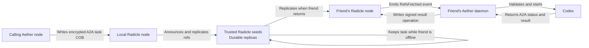

# Radicle as an offline data layer for Aether

Checked on 2026-08-31 against [Radicle 1.10.2](https://radicle.dev/2026/08/26/radicle-1.10.2.html) and the official Heartwood
repository at commit
[`fd4e4903`](https://github.com/radicle-dev/heartwood/commit/fd4e4903d70ef21477653d1b50900aca2bd9a5a0).
Heartwood is a Rust stack under the MIT or Apache-2.0 license.
([project and license](https://github.com/radicle-dev/heartwood/blob/fd4e4903d70ef21477653d1b50900aca2bd9a5a0/README.md#L3-L19))

## Decision

Radicle can keep signed Aether data on one or more seed nodes while a user node
is offline. The user node can fetch that data when it connects again. This can
give Aether durable storage and offline catch-up.

Radicle does not give Aether a complete mailbox. It does not confirm that the
target agent read or processed a message. It also cannot start a stopped agent
or a stopped Aether daemon.

Do not add Radicle to the first Rust proof of concept. Use its design as a model
for a later durable mailbox. Keep A2A as the message and task contract. Keep
Iroh as the direct network path. Add a small stored message log only when
offline delivery is in scope.

## The three separate guarantees

| Property | What Radicle gives | What Aether still needs |
| --- | --- | --- |
| Data durability | A seed can keep a full Git replica, including signed references and collaborative objects. Several seeds can keep copies. | A retention policy, encryption policy, storage limits, and proof that enough mailbox replicas accepted the record. |
| Delivery guarantee | A returning node can learn about changed references and fetch the current repository state. | A recipient cursor, signed receipt, retry rule, expiry, duplicate control, and a clear processed state. |
| Compute wake-up | A running local process can receive node events. A system service can keep `radicle-node` active. | An operating-system service or resident Aether daemon that starts the agent. No peer can start a fully stopped machine or process. |

A successful Radicle sync proves that a selected seed fetched repository
references. It does not prove that the target agent processed the A2A task.
Radicle can try a requested replication factor, but this is a repository
replication result, not an end-user delivery receipt.
([sync rules](https://github.com/radicle-dev/heartwood/blob/fd4e4903d70ef21477653d1b50900aca2bd9a5a0/crates/radicle-cli/src/commands/sync/args.rs#L20-L50))

## Node, seed, and storage behavior

`radicle-node` is a long-running network daemon. A normal node and a public
seed use the same protocol. The main difference is policy and availability. A
seed operator keeps the node online and configures which repositories it will
accept and replicate. A permissive seed can accept all repositories that it
finds. A restricted seed can accept only selected repositories.
([protocol guide](https://radicle.dev/guides/protocol),
[seed guide](https://radicle.dev/guides/seeder))

Each replica is a bare Git repository in local Radicle storage. Peer changes
use separate namespaces. Signed references state which Git objects one peer
publishes. Issues, patches, and identities are collaborative objects, or COBs.
A COB is a signed operation graph stored as Git commits. Peers merge this graph
by set union. This model permits offline edits and later merge.
([COB guide](https://radicle.dev/guides/protocol#collaborative-objects),
[COB identifiers](https://github.com/radicle-dev/heartwood/blob/fd4e4903d70ef21477653d1b50900aca2bd9a5a0/crates/radicle/src/cob.rs#L22-L40))

Discovery and replication are separate:

1. Gossip announces nodes, repository inventories, and signed reference
   updates. Inventory announcements form the repository routing table.
2. A node that wants the content connects to a seed and uses the Git protocol
   to fetch the objects.

At least one seed that has the repository must be online for another node to
find and fetch it. Always-on seeds improve availability. They are not central
servers, because any accepted peer can keep another replica.
([replication model](https://radicle.dev/guides/protocol#replication))

Preferred seeds are persistent peers. The daemon tries to reconnect to them
automatically.
([reconnect behavior](https://github.com/radicle-dev/heartwood/blob/fd4e4903d70ef21477653d1b50900aca2bd9a5a0/crates/radicle-node/src/main.rs#L340-L343))

## Offline peers and later fetch

Another peer can retain an Aether message until the user node reconnects, with
four conditions:

1. Aether stores the message as reachable Git or COB data.
2. The sender publishes a reference to that data.
3. At least one seed policy accepts the repository and fetches the reference.
4. The recipient later connects, learns the current reference, and fetches it.

This is store-and-fetch, not a native per-user mailbox. The seed has repository
state. It does not have a recipient queue, delivery lease, read receipt, or
task acknowledgement.

Radicle stores recent gossip notices in SQLite and can replay matching notices
to a returning peer. This helps a peer find changed references. It is not the
durable message store. The store replaces older notices for the same key, its
default prune age is two weeks, and the first subscription asks for 24 hours of
history. A returning peer starts from its last stored gossip time with an
overlap.
([gossip store](https://github.com/radicle-dev/heartwood/blob/fd4e4903d70ef21477653d1b50900aca2bd9a5a0/crates/radicle-protocol/src/service/gossip/store.rs#L31-L67),
[store update](https://github.com/radicle-dev/heartwood/blob/fd4e4903d70ef21477653d1b50900aca2bd9a5a0/crates/radicle-protocol/src/service/gossip/store.rs#L96-L125),
[default age](https://github.com/radicle-dev/heartwood/blob/fd4e4903d70ef21477653d1b50900aca2bd9a5a0/crates/radicle/src/node/config.rs#L803-L817),
[reconnect range](https://github.com/radicle-dev/heartwood/blob/fd4e4903d70ef21477653d1b50900aca2bd9a5a0/crates/radicle-protocol/src/service.rs#L1945-L1970))

Therefore, an Aether client must treat gossip as a hint. After every start or
reconnect, it must fetch the durable repository state and scan records after
its own cursor. It must not depend on complete event replay.

## Inbox, events, and wake-up

The Radicle inbox is a local notification database. The node writes a
notification after it pulls an updated reference. Notifications identify COB,
branch, or unknown reference changes and have read or unread state.
([notification types](https://github.com/radicle-dev/heartwood/blob/fd4e4903d70ef21477653d1b50900aca2bd9a5a0/crates/radicle/src/node/notifications.rs#L20-L68),
[persistent store](https://github.com/radicle-dev/heartwood/blob/fd4e4903d70ef21477653d1b50900aca2bd9a5a0/crates/radicle/src/node/notifications/store.rs#L110-L190))

This inbox is not a remote mailbox. Notifications are created after a pull,
not for the first clone. They are limited to repositories to which the local
node has contributed.
([fetch rule](https://github.com/radicle-dev/heartwood/blob/fd4e4903d70ef21477653d1b50900aca2bd9a5a0/crates/radicle-node/src/worker/fetch.rs#L137-L148))

A running program can subscribe to the node control socket and receive live
events such as `RefsFetched` and `RefsSynced`. This can wake an active Aether
bridge without repeated HTTP polling. The local event feed is not durable. It
has an in-memory limit of 8,192 pending events and removes a subscriber when
its channel is full. The implementation has no cursor, receipt, or replay step.
The last statement is an inference from the code.
([event types](https://github.com/radicle-dev/heartwood/blob/fd4e4903d70ef21477653d1b50900aca2bd9a5a0/crates/radicle/src/node/events.rs#L17-L47),
[event channel](https://github.com/radicle-dev/heartwood/blob/fd4e4903d70ef21477653d1b50900aca2bd9a5a0/crates/radicle/src/node/events.rs#L201-L247))

Radicle cannot cold-start compute. The supplied systemd unit keeps the daemon
active and restarts it after failure. It does not start an agent after a
repository update.
([system service](https://github.com/radicle-dev/heartwood/blob/fd4e4903d70ef21477653d1b50900aca2bd9a5a0/systemd/system/radicle-node.service#L12-L21))

## Identity, privacy, and reachability

A Radicle node has an Ed25519 Node ID. Repository identity documents use
`did:key` identifiers. Peers sign published references. Direct network
connections use the Noise XK handshake. The responder identity must be known
before the handshake.
([identity and transport](https://radicle.dev/guides/protocol#identity),
[Noise XK source](https://github.com/radicle-dev/heartwood/blob/fd4e4903d70ef21477653d1b50900aca2bd9a5a0/crates/radicle-node/src/wire.rs#L1-L46))

Private repositories use an identity allowlist and selective replication. This
is access control, not encrypted storage. An accepted seed can read the Git
objects that it stores. Aether would need application-level encryption if an
untrusted seed holds private agent messages.
([private repositories](https://radicle.dev/guides/protocol#private-repositories))

Radicle public seeds are expected to have a public, static network address and
an open TCP port. Bootstrap nodes help fill the address book. Tor is supported,
but the standard seed design does not give Iroh-style direct path selection,
hole punching, and relay fallback. A node behind NAT can make an outbound
connection to a public seed and fetch later. A peer cannot reach it while the
node and all of its network paths are offline.
([seed network requirements](https://radicle.dev/guides/seeder#network-configuration))

## Comparison with Aether, A2A, and Iroh

| Need | Radicle | Aether design |
| --- | --- | --- |
| Agent discovery | Finds nodes and repository replicas. It does not index agent skills. | The Aether directory indexes A2A Agent Cards and skills. |
| Message contract | Git objects and extensible COB operations. No agent task lifecycle. | A2A owns messages, tasks, status, artifacts, and receipts at the application layer. |
| Direct transport | Noise-encrypted TCP and Git replication between known nodes. | Iroh gives encrypted QUIC, direct paths, NAT traversal, and relay fallback. |
| Offline data | Online seed nodes can keep complete repository copies. | A later mailbox can retain the original A2A envelope. |
| Live wake | Control-socket events can notify a running local bridge. | A resident Aether daemon can block on Iroh or mailbox notifications. |
| Cold wake | An external service manager keeps the node active. | An external supervisor must start the daemon or agent. |
| Processing receipt | Not part of repository replication. | Aether needs a signed recipient acknowledgement and task state. |

A2A update methods, such as streaming and webhooks, do not create an offline
mailbox. Iroh relays are stateless and do not keep application data. Thus,
neither one replaces the durable layer described here.
([A2A task updates](https://a2a-protocol.org/dev/specification/#35-task-update-delivery-mechanisms),
[Iroh relay behavior](https://docs.iroh.computer/concepts/relays#why-relays-are-better))

## Possible Radicle-backed task flow

Radicle can be the durable path without replacing A2A or Iroh:

The flow needs these rules:

1. The directory record includes the agent's Iroh Endpoint ID, Radicle Node ID,
   and inbox Repository ID.
2. The caller writes the original A2A envelope as an operation on an
   `xyz.aether.task` COB in a shared private inbox repository.
3. The caller waits for `RefsSynced` from the required number of trusted seeds
   before it reports the task as `stored`.
4. Iroh sends a fast notification when the recipient is online. The Radicle
   record remains the authoritative task state.
5. The recipient daemon reacts to `RefsFetched`. It also scans all task records
   after each start because the live node event can be lost.
6. The recipient uses the task ID as a duplicate-control key, starts Codex, and
   writes signed A2A status and result operations to the same COB.
7. Private A2A payloads use application-level encryption. A trusted seed can
   otherwise read all Git objects that it stores.

This design supports at-least-once processing. The signed result and recipient
cursor prevent the same task from starting Codex twice. Exactly-once execution
is not a realistic network guarantee.

## Options for Aether

### Use Radicle directly

Aether could define a custom COB type for messages or tasks. A trusted set of
seed nodes could replicate the repository. An agent would use node events as
live hints and scan COB state after each restart. This gives signed,
content-addressed history and multi-peer storage.

This option has a high cost for the first Rust proof. The official stack uses
Rust, but it still adds Git storage and a network daemon. Its replication scope
is a repository, not one recipient queue. Aether could use Radicle crates or
control the daemon through its socket. It would still have to add mailbox
receipts, task claims, expiry, encryption, and process supervision.

### Use a Radicle-inspired mailbox

This is the better later design for Aether:

1. Store the original A2A message or task envelope as a signed,
   content-addressed record.
2. Use one ordered recipient log and one durable cursor for each agent.
3. Replicate each record to a small configured quorum of mailbox peers.
4. Report `stored` when the quorum accepts it. Do not report `delivered` yet.
5. Let the recipient write a signed `received` or `processed` record.
6. Use live events only as hints. Scan the log after each start and reconnect.
7. Encrypt private records for the recipient before a mailbox peer stores
   them.
8. Keep a small supervised Aether daemon active. Start the expensive agent only
   when accepted work arrives.

This design copies Radicle's useful separation of signed durable state,
replication, and live announcements. It does not copy Git repository scope or
source-code collaboration rules.

## Proof recommendation

For the first proof, keep the current boundary:

1. Use the Aether directory for Agent Card and skill search.
2. Use A2A for one message or task exchange.
3. Use Iroh for the direct connection.
4. Return a clear offline result when the target daemon cannot connect.
5. Do not claim durable delivery or cold wake-up.

For the next proof, add the small mailbox described above. Test Radicle only if
the project needs multi-writer signed history, repository-level replication,
and operation without one mailbox service. For normal agent messages, a small
purpose-built replicated log is a closer fit.
